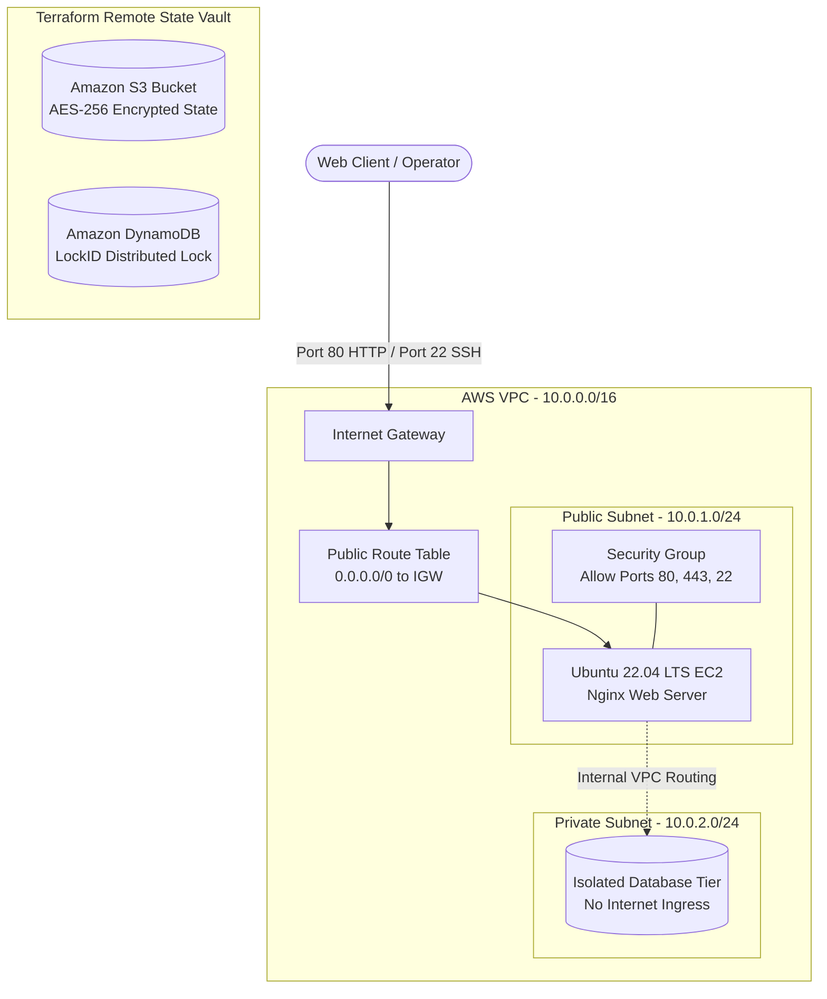

# Production AWS Infrastructure and GitOps Pipeline

A production-grade, secure AWS cloud architecture provisioned entirely through Terraform Infrastructure as Code (IaC), automated via a GitHub Actions GitOps CI/CD pipeline, and audited using a custom Python Boto3 FinOps script.

---

## Architecture Overview



---

## Key Technical Implementations

### 1. Remote State Management and Concurrency Locking
* **State Storage:** Remote backend configured in Amazon S3 with AES-256 server-side encryption, versioning enabled for state history rollback, and strict public access block policies.
* **Distributed Locking:** Concurrency control managed by Amazon DynamoDB using `LockID` string hashing to prevent race conditions during simultaneous pipeline executions.

### 2. Network Isolation and Route Topologies
* **VPC:** Custom Class B private network (`10.0.0.0/16`) provisioned in `us-east-1`.
* **Public Subnet (`10.0.1.0/24`):** Bound to an AWS Internet Gateway via custom route table (`0.0.0.0/0`) for web-facing workloads.
* **Private Subnet (`10.0.2.0/24`):** Isolated subnet with local-only route table for backend and database workloads, completely hidden from public ingress.

### 3. Least-Privilege Security Group
* Inbound ingress restricted exclusively to Port 80 (HTTP), Port 443 (HTTPS), and Port 22 (SSH).
* Stateful evaluation ensures return traffic is automatically handled without opening extraneous ports.

### 4. Automated Compute and Key Generation
* **AMI Discovery:** Automated dynamic lookup for the latest Canonical Ubuntu 22.04 LTS AMI.
* **Key Generation:** Cloud-portable 4096-bit RSA cryptographic keypair generation using Terraform TLS provider, eliminating external local file dependencies.
* **Bootstrap:** Cloud-init user-data automation deploying and initializing Nginx web server on initial instance launch.

### 5. FinOps Cost Auditing (Python + Boto3)
* Real-time automated auditing script (`sweeper.py`) scanning target AWS regions for orphaned EBS storage volumes and unattached Elastic IP addresses to prevent idle resource billing.

### 6. GitOps CI/CD Pipeline (GitHub Actions)
* **Pull Request Workflow:** Executes automated code formatting check (`terraform fmt -check`), configuration validation (`terraform validate`), and speculative execution plan (`terraform plan`).
* **Main Branch Deployment:** Executes zero-touch deployment (`terraform apply -auto-approve`) only upon successful merge into the `main` branch.

---

## Technical Specifications

| Category | Specification |
| :--- | :--- |
| **Infrastructure as Code** | Terraform v1.5+ |
| **Cloud Provider** | Amazon Web Services (AWS) |
| **Region** | `us-east-1` (N. Virginia) |
| **Compute** | EC2 `t2.micro` (Ubuntu 22.04 LTS, 8GB gp3 EBS) |
| **Network** | 1 VPC, 2 Subnets (1 Public, 1 Private), 1 Internet Gateway, 2 Route Tables |
| **Security** | Security Group (Ports 80, 443, 22), S3 Bucket Public Access Block |
| **CI/CD** | GitHub Actions (`ubuntu-latest` runner) |
| **Scripting / SDK** | Python 3.10+, Boto3, Botocore |

---

## Repository Structure

```text
├── .github/workflows/
│   └── terraform.yml       # GitHub Actions CI/CD pipeline definition
├── backend.tf              # S3 backend and DynamoDB locking configuration
├── vpc.tf                  # VPC, subnets, gateway, and route table definitions
├── security.tf             # Security group firewall rules
├── compute.tf              # EC2 instance, dynamic AMI query, and TLS keypair
├── outputs.tf              # Infrastructure output declarations
├── sweeper.py              # Boto3 cost auditing script
├── .gitignore              # VCS exclusions (state files, caches, secrets)
└── README.md               # Architecture documentation
```

---

## Deployment and Lifecycle Commands

### Prerequisites
* AWS CLI v2 configured with appropriate IAM credentials
* Terraform v1.5+ installed
* Python 3.10+ with Boto3 installed

### Local Execution

```bash
# Initialize providers and remote backend
terraform init

# Validate syntax and configuration
terraform fmt -check
terraform validate

# Run speculative execution plan
terraform plan

# Provision infrastructure
terraform apply

# Run FinOps auditor script
python3 sweeper.py

# Destroy infrastructure
terraform destroy
```

---

## Author
Albin — Full-Stack Developer transitioning to Cloud and DevOps Engineering.
